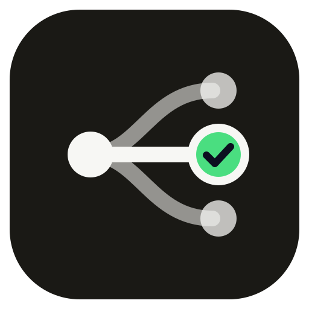
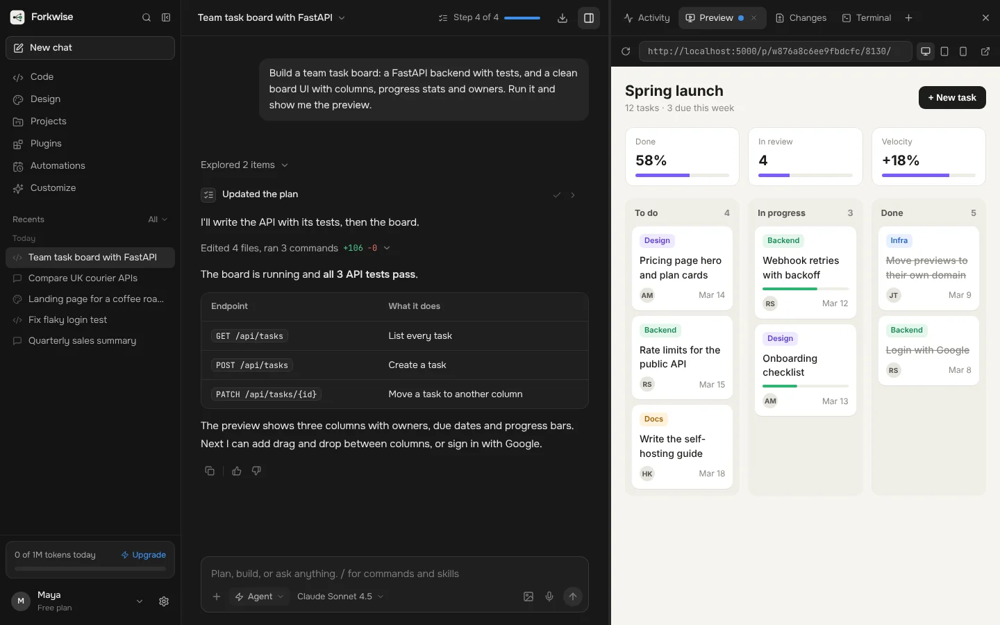
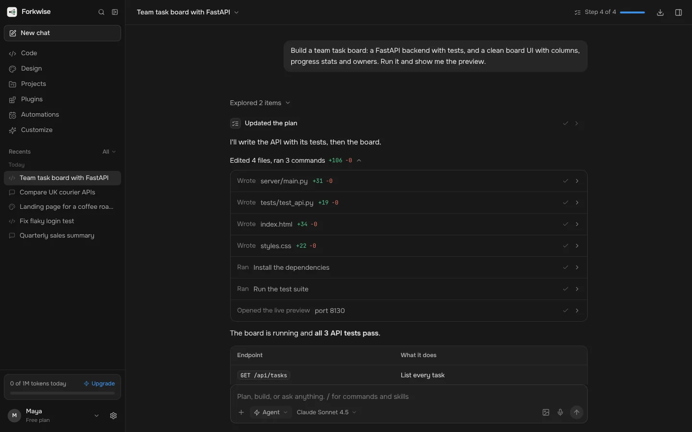
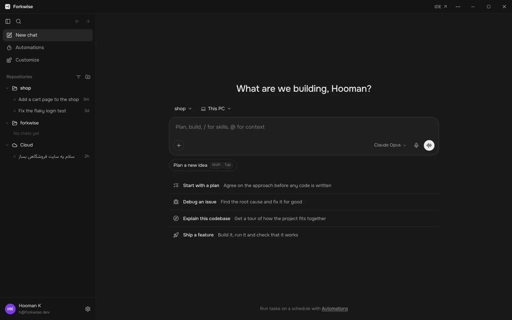
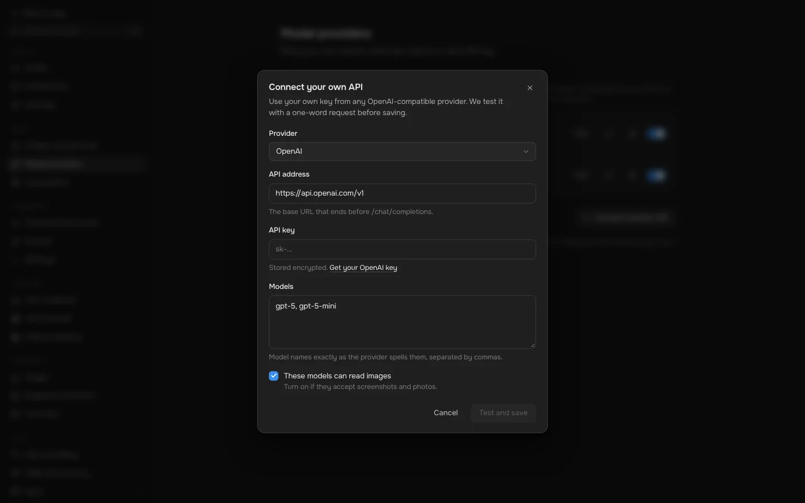
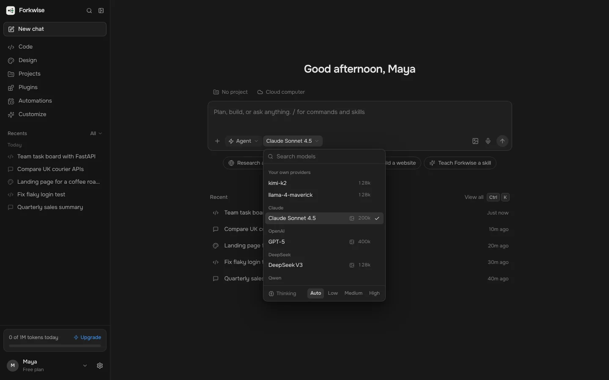
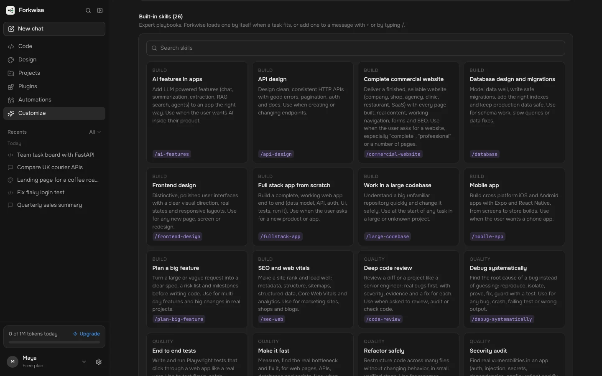
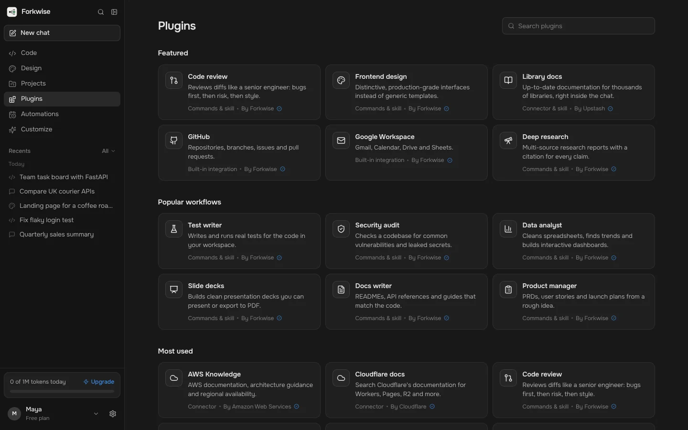
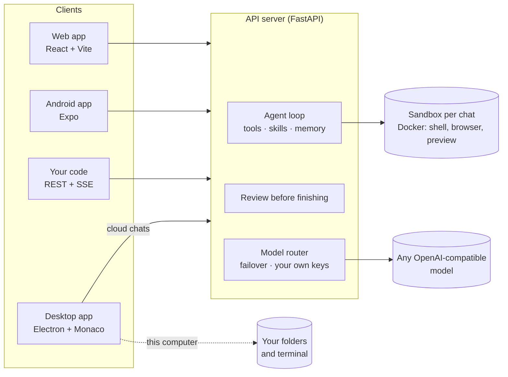

<div align="center">

<a href="https://forkwiseai.com"></a>

# Forkwise

### The open-source AI engineer that plans, builds, runs and checks real projects.

Describe the app, site or fix you want. Forkwise plans it, writes the code on its own computer, runs it, opens it in a browser, tests it and keeps going until it actually works.

[](LICENSE)
[](https://github.com/hoomanyyy/Forkwise-AI/stargazers)
[](CONTRIBUTING.md)
[](https://forkwiseai.com)

[**Try it free**](https://forkwiseai.com) · [**Download the desktop app**](https://github.com/hoomanyyy/forkwise-releases/releases/tag/current) · [**Self-host**](#-self-host-in-5-minutes) · [**Docs**](https://forkwiseai.com/docs) · [**API**](https://forkwiseai.com/developers)

<br>



</div>

<br>

## Why Forkwise

Most AI coding tools write code and hand it back to you. Forkwise **finishes the job**:

- 🖥️ **It has a real computer.** Every chat gets an isolated Linux machine. It installs packages, starts servers, runs tests and opens your app in a browser, then fixes what breaks.
- ✅ **It checks its own work.** Before it may say "done", an automatic review looks at what really happened: unfinished tasks, failed builds, apps that were never started, giant single files. If anything is wrong, it goes back to work.
- 👀 **Nothing happens behind your back.** Every read, edit, command and test shows up live, grouped into clear steps, next to a workspace with preview, files, changes, terminals and the plan.
- 🔑 **Bring any model.** Use Claude, GPT, Gemini, DeepSeek, Qwen, Llama, Mistral, Kimi and more, or connect **your own API key** and even **local models** through Ollama or LM Studio.
- 💻 **It works where you work.** In the browser, in a Cursor-style desktop app on your own folders, from your phone, or from your own code through the API.
- 🔓 **It is yours.** The agent and the web app are open source under AGPL-3.0, the same core that runs [forkwiseai.com](https://forkwiseai.com). Read it, host it, change it.

<br>

## ✨ Features

<table>
<tr>
<td width="50%" valign="top">

### Watch it work, step by step
Long runs stay readable: steps are grouped into one line you can open into a card, with diffs, command output and timings.



</td>
<td width="50%" valign="top">

### Desktop app: an editor built around the agent
File explorer, Monaco tabs, real terminals and the agent on the right. Switch between **this computer** and **the cloud** from the title bar. A free download for Windows, macOS and Linux.



</td>
</tr>
<tr>
<td width="50%" valign="top">

### Your own API keys
Connect OpenAI, Anthropic, Gemini, OpenRouter, DeepSeek, xAI, Groq, Mistral or any OpenAI-compatible endpoint. Keys are tested, encrypted and never shown again.



</td>
<td width="50%" valign="top">

### Every model, one picker
Grouped by maker, with search, context sizes and a thinking level. Your own providers sit at the top.



</td>
</tr>
<tr>
<td width="50%" valign="top">

### 26 expert skills
Step-by-step playbooks written the way senior engineers work: full stack apps, frontend design, APIs, databases, debugging, code review, security audits, performance, deploys, research and data analysis.



</td>
<td width="50%" valign="top">

### Plugins and connectors
GitHub, Google, any MCP server, plus a directory of featured connectors and ready-made workflows.



</td>
</tr>
</table>

**And also:** checkpoints on every message (go back and your files come back too) · Agent, Plan and Ask-first modes · memory across chats · projects with their own instructions · scheduled tasks · encrypted secrets · image and video generation · Forkwise for Chrome · desktop and Android apps · a public API with live event streams.

<br>

## 🚀 Get started

| | |
| --- | --- |
| **Use it now** | Sign up free at [forkwiseai.com](https://forkwiseai.com). Nothing to install. |
| **Desktop app** | Windows, macOS and Linux from [forkwise-releases](https://github.com/hoomanyyy/forkwise-releases/releases/tag/current). |
| **Android** | The APK is on the same [download page](https://github.com/hoomanyyy/forkwise-releases/releases/tag/current). |
| **Self-host** | Run the open-source core in a few minutes, below. |

<br>

## 🏠 Self-host in 5 minutes

You need **Python 3.11+**, **Node.js 20+** and a key from any OpenAI-compatible provider (or a local Ollama).

```bash
git clone https://github.com/hoomanyyy/Forkwise-AI forkwise
cd forkwise/backend
cp .env.example .env
```

Set these in `backend/.env`:

```ini
SANDBOX=local                       # or "docker" for an isolated computer per chat
DATA_DIR=./data
API_URL=http://localhost:5000
SITE_URL=http://localhost:5173
LLM_BASE_URL=https://openrouter.ai/api/v1
LLM_API_KEY=sk-...
LLM_MODELS=anthropic/claude-sonnet-4.5=Claude Sonnet 4.5,openai/gpt-5=GPT-5
```

Start the API, then the web app in a second terminal:

```bash
pip install -r requirements.txt && ./run.sh          # http://localhost:5000

cd ../frontend && npm install && npm run dev         # open http://localhost:5173
```

<details>
<summary><b>Isolated computers with Docker</b></summary>

```bash
docker build -t forkwise-sandbox backend/sandbox
```

Set `SANDBOX=docker`. Each chat then runs in its own container, limited by `SANDBOX_MEMORY`, `SANDBOX_CPUS` and `SANDBOX_IDLE_MINUTES`.

</details>

<details>
<summary><b>Production server (one command)</b></summary>

On Ubuntu or Debian (or a dnf-based distribution), with a domain pointed at the server:

```bash
curl -fsSL https://raw.githubusercontent.com/hoomanyyy/Forkwise-AI/main/backend/deploy/install.sh -o install.sh
sudo LLM_API_KEY=sk-... LLM_MODELS="model-id=Label" \
  bash install.sh --api-domain api.example.com --site https://example.com
```

It installs the API as a service behind nginx with HTTPS, builds the sandbox image and keeps settings in `/opt/forkwise/backend.env`. Update any time with `sudo forkwise-update`. Build the web app with `npm run build` (set `VITE_API_URL`) and serve `frontend/dist` from any static host.

</details>

<details>
<summary><b>Local models (Ollama, LM Studio)</b></summary>

Set `ALLOW_PRIVATE_PROVIDERS=1` in `backend/.env`, then in **Settings → Model providers → Connect an API** choose *Custom (OpenAI compatible)* with `http://localhost:11434/v1` (Ollama) or `http://localhost:1234/v1` (LM Studio). Pick a model that supports tool calling.

</details>

Everything else (email, Google and GitHub sign-in, web search, MySQL, payments, plan limits) is documented in [`backend/.env.example`](backend/.env.example) and the [self-hosting guide](https://forkwiseai.com/docs/self-hosting).

<br>

## 🔌 Use it from your own code

```bash
# 1. start a chat
curl https://api.forkwiseai.com/api/chats \
  -H "Authorization: Bearer $FORKWISE_KEY" -H "Content-Type: application/json" -d '{}'

# 2. give it a task
curl https://api.forkwiseai.com/api/chats/CHAT_ID/messages \
  -H "Authorization: Bearer $FORKWISE_KEY" -H "Content-Type: application/json" \
  -d '{"content": "Build a REST API for a todo app with tests"}'

# 3. watch every step, live (server-sent events)
curl -N https://api.forkwiseai.com/api/runs/RUN_ID/events -H "Authorization: Bearer $FORKWISE_KEY"
```

Fix failures from CI, send reports from a cron job, or add an AI engineer to your own product. See the [API reference](https://forkwiseai.com/docs/api).

<br>

## 🧱 How it is built



| Folder | What lives there |
| --- | --- |
| [`backend/`](backend) | FastAPI server: auth, chats, the agent loop and its 30 tools, 26 skills, MCP, checkpoints, schedules, billing, the public API |
| [`backend/sandbox/`](backend/sandbox) | The Docker image every chat runs in: Python, Node, a headless browser, the preview proxy |
| [`backend/deploy/`](backend/deploy) | One-command server install, updates, nginx and firewall |
| [`frontend/`](frontend) | The web app: chat, workspace, projects, settings and admin |

### What is open and what is not

This repository is the **Forkwise core**: everything you need to run your own Forkwise. The desktop app, the Android app and the forkwiseai.com website are built on top of it and are distributed as free downloads, not as source. They talk to the core through the same public API that is documented here.

<br>

## 🤝 Contributing

Bug fixes, new skills, new tools, docs and translations are all welcome. Read [CONTRIBUTING.md](CONTRIBUTING.md) to get set up, then pick an [issue](https://github.com/hoomanyyy/Forkwise-AI/issues) or open one to discuss your idea. Small pull requests are merged fastest.

Found a security problem? Please report it privately, see [SECURITY.md](SECURITY.md).

<br>

## ⭐ Support the project

If Forkwise saves you time, **star the repo**. It helps more people find it, and it keeps us building in the open.

<a href="https://star-history.com/#hoomanyyy/Forkwise-AI&Date">
  
</a>

<br>

## License

[GNU AGPL-3.0](LICENSE). Use it, self-host it and change it freely. If you offer a modified version to others as a network service, the AGPL asks you to publish your changes under the same license. For a commercial license without that obligation, contact support@forkwiseai.com.

The Forkwise name and logo are trademarks and are not covered by the license; please give your fork its own name.
